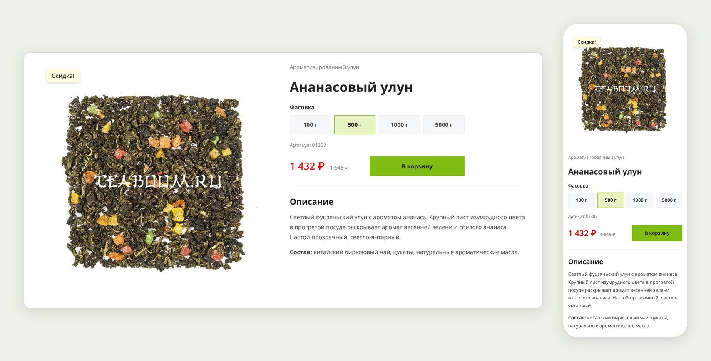

# Карточка товара «Ананасовый улун»

Вёрстка верхней части карточки товара для интернет-магазина чая Teaboom.ru: фото, цены, выбор фасовки и описание. Выполнено как тестовое задание.

**Демо:** https://alexanderkoldin.github.io/teaboom-product-card/



## Запуск

Открыть ссылку на демо — или склонировать репозиторий и открыть `index.html` в браузере. Сборка и установка зависимостей не нужны.

```bash
git clone https://github.com/AlexanderKoldin/teaboom-product-card.git
```

## Стек

- HTML5 — семантическая разметка
- CSS3 — Grid, Flexbox, custom properties, логические свойства, `clamp()`
- JavaScript (ES6+) — без фреймворков и библиотек

## Что реализовано

- Изображение, название, категория, артикул, актуальная и старая цена, кнопка «В корзину», короткое описание
- Переключатель фасовки: при выборе меняются цена, старая цена, артикул и выбранное состояние
- Старая цена и плашка «Скидка!» показываются только при наличии скидки
- Кнопка с обычным состоянием, состоянием при наведении и фокусом с клавиатуры
- Адаптив: 1440 / 768 / 375 px, подход mobile-first

## Решения

### Переключатель фасовки

- Фасовка сделана на `radio` внутри `fieldset` с `legend`: это выбор одного варианта из группы, поэтому клавиатура (Tab, стрелки) и озвучка экранными читалками работают без дополнительного кода.
- Выбранное состояние — чистый CSS (`:checked + …`), JS отвечает только за цены и артикул.
- Данные фасовок хранятся в `data-*` атрибутах на каждом варианте.
- Обработчик один, на `fieldset` (делегирование, событие `change`).
- В HTML сразу стоят цены фасовки по умолчанию — страница корректна и без JS. При загрузке скрипт синхронизирует цену с выбранным вариантом: браузеры восстанавливают состояние формы после перезагрузки.
- Блоку цен зарезервирована ширина, чтобы кнопка не сдвигалась при переключении фасовки.

### Цены

- Формат по ТЗ через `Intl.NumberFormat('ru-RU')`: пробелы между разрядами, запятая, неразрывный пробел перед ₽.
- Копейки показываются, только если они есть: `326,40 ₽`, но `1 432 ₽`.

### Доступность

- Кружки `radio` скрыты визуально, но доступны клавиатуре и читалкам (`.visually-hidden`, не `display: none`).
- Фокус с клавиатуры виден (`:focus-visible`), при клике мышью рамка не появляется.
- Старая цена — тег `<s>` с невидимой подписью «Старая цена:», так как читалки не озвучивают зачёркивание.
- `aria-live="polite"` на блоке цен: читалка объявляет новую цену при смене фасовки.
- Цвета проверены на контраст по WCAG AA.

### Отличия от сайта Teaboom.ru

Стилистика сайта сохранена: шрифт Open Sans, фирменные цвета, прямые углы, плашка «Скидка!». Изменения сделаны осознанно:

- Фасовка — переключатель с одной ценой и одной кнопкой вместо четырёх строк с отдельными кнопками (по ТЗ).
- Категория и короткое описание вынесены в карточку (на сайте — в хлебных крошках и во вкладке).
- Цена `#ff0000` → `#e00000`: контраст на белом 4.0 → 5.0 (WCAG AA ≥ 4.5).
- Старая цена и артикул `#808080` → `#707070`: тоже под контраст.
- Цена 24px вместо 18px — главный элемент для покупателя.
- Артикул 12px вместо 9.8px — читается на телефоне.
- На зелёной кнопке тёмный текст: белый на `#80bc14` даёт контраст 2.3.
- Размеры шрифтов округлены: дробные значения на сайте — побочный эффект `em` в Bootstrap.

### Производительность

- Фото через `<picture>`: WebP (−21% веса) с JPG как запасным вариантом, `width`/`height` против сдвигов вёрстки, `fetchpriority="high"` для главного изображения.
- Шрифт подключён локально (woff2, только нужные начертания, кириллица + латиница) с `font-display: swap`.

## Структура

```
├── index.html
├── css/style.css
├── js/main.js
├── fonts/          Open Sans 400 / 600 / 700, woff2
├── images/         фото товара, WebP + JPG
├── docs/           скриншот для README
└── favicon.ico
```

## Материалы

Фотография, описание товара и favicon взяты с сайта [teaboom.ru](https://teaboom.ru) в рамках тестового задания. Шрифт Open Sans распространяется по лицензии SIL Open Font License.
